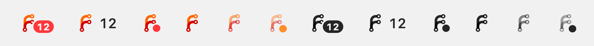

# Forgejo Notifications

A macOS menu bar app for your Forgejo notifications: the Forgejo logo with an unread badge, a click-through list, "Read all", and filters that turn the default firehose into what you actually care about.




## Install

Requires macOS 14+ and the Xcode Command Line Tools (`xcode-select --install`).

```sh
make install      # builds "Forgejo Notifications.app", copies it to ~/Applications, launches it
```

`make app` builds into `build/` without installing. Opening the app again (Spotlight, Finder) brings up Settings, which helps when a menu bar manager has hidden the item.

## Using it

- **Click** the icon for the list. Click a notification to open it in your browser: the latest comment if there is one, otherwise the issue, PR, commit or repo. It's marked read when you open it (you can turn that off).
- **Hover** a row and click ✓ to mark just that one read.
- **Read all** sits in the popover header. By default it clears everything unread on the server, including filtered-out items. Settings → Filters → *Read all marks* can limit it to the shown list.
- **Right-click** the icon for Refresh, Mark All as Read, Open in Browser, Settings and Quit.
- **Terminal**: `ForgejoNotify --print` lists what the menu bar would show, with your filters applied.

## Signing in

Settings → Account offers three options:

| Mode | How it works |
| --- | --- |
| **tea login** (default) | Reads `~/Library/Application Support/tea/config.yml` (or `~/.config/tea/`, or `$XDG_CONFIG_HOME/tea/`). Read-only. For logins made with `tea login add --oauth`, the app never refreshes tea's token itself, because that would rotate the refresh token out from under tea. When the token expires, it runs `tea whoami` so tea refreshes its own token, then re-reads the config. |
| **OAuth** | Browser sign-in using the authorization code flow with PKCE and a loopback redirect (`http://127.0.0.1:<random port>`). It goes through your normal Forgejo login page, so SSO and 2FA work. The default client ID is Forgejo's built-in `git-credential-oauth` app. To use your own app instead, create one under Settings → Applications → OAuth2 with *Confidential client* unchecked and redirect URI `http://127.0.0.1`, then paste its client ID. Tokens are stored in the Keychain and refreshed automatically. |
| **Access token** | Paste a token with `read:notification`, `write:notification`, `read:issue`, `read:repository` and `read:user`. Stored in the Keychain. |

Secrets go into the login Keychain through `/usr/bin/security`, piped over stdin, so they never appear in a process listing. Reading them back doesn't prompt, even after a rebuild re-signs the app.

## Filters

Settings → Filters decides what shows in the list and counts toward the badge. Your notifications on the server don't change, unless you turn on auto-read.

- **Kinds**: issues, pull requests, commits, releases. You can also hide closed issues, merged PRs and draft PRs.
- **Only things I'm involved in**: you opened it, are assigned, are a requested reviewer, or are @mentioned in the latest comment.
- **Repositories**: an allow-list and/or a block-list. One-click "hide" buttons appear for the repos filling your inbox.
- **Hide authors**, **hide when the last comment is by**, **hide labels**, **hide titles containing**: comma-separated and case-insensitive, with `*` globs (`renovate, *bot`, `chore(deps)*`).
- **Automatically mark filtered-out notifications as read**: off by default.

Author, label, draft, comment and involvement filters need the issue or PR itself. The app looks each one up once and caches it until the thread changes (`~/Library/Application Support/ForgejoNotify/enrichment.json`). The popover footer shows how many items are hidden, and you can expand them inline.

## Menu bar options

- Icon: Forgejo colors or monochrome. Monochrome follows the menu bar's light/dark text color.
- Unread count: badge, number next to the logo, dot, or none.
- The icon dims when nothing is unread (optional) and while loading. An orange dot means an error; the popover explains it.
- Optional macOS banners for new items that pass your filters. Clicking a banner opens the item.

## Development

```sh
swift build
swift run ForgejoNotify --print                 # live list in the terminal
swift run ForgejoNotify --render-previews docs  # regenerate the images above
FORGEJO_NOTIFY_DEBUG=1 "build/Forgejo Notifications.app/Contents/MacOS/ForgejoNotify"   # log requests
```

| File | What's in it |
| --- | --- |
| `ForgejoAPI.swift` | REST calls: list, mark read, mark all, issue/PR/comment lookups |
| `Auth.swift` | tea config reader, Keychain, OAuth PKCE + loopback listener, credential renewal |
| `Filters.swift` | Filter rules and glob matching |
| `NotificationStore.swift` | Polling, enrichment cache, optimistic reads |
| `Logo.swift` | Forgejo logo (drawn from its SVG geometry), menu bar renderer, app icon |
| `StatusItemController.swift`, `PopoverView.swift`, `SettingsView.swift` | UI |
